# API Segura — Secure Task Manager (Node.js + Flutter)

Desarrollo de la actividad **"Full-Stack Tutorial: Secure Node.js API with a Flutter Client"**: un gestor de tareas con registro, inicio de sesión y CRUD de tareas. El cliente Flutter consume una API REST versionada hecha con Node.js, Express, PostgreSQL y Prisma.

| Carpeta | Contenido |
|---|---|
| [`backend/`](backend) | API REST por capas (routes → controllers → services → repositories), Prisma, Jest + Supertest |
| [`mobile/`](mobile) | App Flutter organizada por features (Riverpod, `http`, `flutter_secure_storage`) |
| [`docs/evidencias/`](docs/evidencias) | Salidas de pruebas y capturas de pantalla |

## Arquitectura

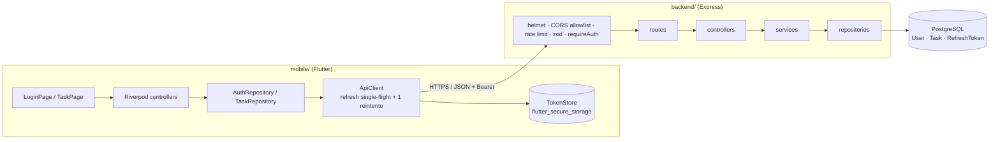

La API no confía en la entrada del cliente ni en IDs de usuario enviados por él: la identidad sale del access token verificado y **cada consulta de tareas filtra por `id` + `ownerId`** (previene IDOR).

### Endpoints (`/api/v1`)

| Método | Ruta | Auth | Descripción |
|---|---|---|---|
| POST | `/auth/register` | — | Crea cuenta (bcrypt costo 12) y devuelve par de tokens |
| POST | `/auth/login` | — | Login con mensaje genérico de error |
| POST | `/auth/refresh` | — | Rota el refresh token; reuso ⇒ revoca toda la familia |
| POST | `/auth/logout` | — | Revoca la familia del refresh token |
| POST | `/auth/logout-all` | Bearer | Revoca todos los refresh tokens del usuario |
| GET | `/tasks?page=&limit=` | Bearer | Lista paginada (máx. 100) solo del usuario |
| POST | `/tasks` | Bearer | Crea tarea |
| GET / PATCH / DELETE | `/tasks/:taskId` | Bearer | Lee / edita / elimina una tarea propia |

Contrato completo en [`backend/openapi.yaml`](backend/openapi.yaml).

## Cómo ejecutarlo

### Backend

```bash
cd backend
docker compose up -d          # PostgreSQL 16 en el puerto 5433
cp .env.example .env          # y reemplaza los secretos JWT por valores aleatorios largos
npm install
npx prisma migrate dev
npm run dev                   # http://localhost:3000
```

Pruebas (usan una base aislada `task_manager_test` configurada en `.env.test`, copia de `.env.example` con `NODE_ENV=test`):

```bash
npm run db:test:migrate
npm test
```

> El `compose.yaml` publica PostgreSQL en el puerto **5433** porque en el equipo de desarrollo ya había un PostgreSQL 17 en el 5432. Durante el desarrollo Docker Desktop no pudo iniciar (el usuario no pertenece al grupo `docker-users`), así que se levantó un clúster PostgreSQL local equivalente con `initdb`/`pg_ctl` usando las mismas credenciales y puerto del `compose.yaml`.

### Cliente Flutter

```bash
cd mobile
flutter pub get
flutter test
# Emulador Android (10.0.2.2 = host):
flutter run --dart-define=API_BASE_URL=http://10.0.2.2:3000/api/v1
# Web / escritorio (agrega el origen a CORS_ORIGINS del backend):
flutter run -d chrome --dart-define=API_BASE_URL=http://localhost:3000/api/v1
```

## Medidas de seguridad implementadas

| Práctica | Implementación |
|---|---|
| Autorización a nivel de objeto | `task.repository.js` filtra siempre por `id` **y** `ownerId`; `ownerId` del cliente se ignora |
| Tokens de acceso cortos | JWT HS256, 10 min, `iss`/`aud`/`type` verificados |
| Refresh tokens | Opacos (48 bytes aleatorios), solo se guarda su **SHA-256**, 7 días, rotación en cada uso, `familyId` para detección de reuso, transacción Prisma |
| Contraseñas | bcrypt costo 12; comparación contra hash señuelo si el email no existe (mismo tiempo/mensaje) |
| Validación | Zod en body, query y params (incluido el formato del `taskId`); body limitado a 20 kb |
| Rate limiting | 10 req/15 min en register/login, 30 en refresh/logout |
| Errores seguros | Manejador central sin stack traces ni detalles SQL; JSON malformado ⇒ 400 genérico |
| Cabeceras y CORS | `helmet`, `x-powered-by` deshabilitado, allowlist de orígenes (origen no permitido ⇒ 403) |
| Logs | `pino-http` con redacción de `authorization`, cookies, `password` y `refreshToken` |
| Secretos | `.env` ignorado por git; solo se versiona `.env.example` con placeholders; `config.js` valida el entorno al iniciar |
| Cliente | Tokens en `flutter_secure_storage`; un único refresh concurrente (single-flight) y como máximo un reintento; logout limpia almacenamiento aunque falle la red; mensajes de error que nunca incluyen tokens ni cuerpos del servidor |

---

# Evidencias

Todas las evidencias se generaron el 26/10/2026 contra la API corriendo localmente. Ningún token real aparece en ellas.

## 1. Pruebas automatizadas del backend (Jest + Supertest) — 20/20

Incluye las pruebas pedidas en la sección 20: registro, credenciales incorrectas, entrada inválida, falta de token, propiedad de tareas, límites de paginación, errores seguros, ciclo de vida del refresh token y que **el usuario A no puede leer, editar ni borrar la tarea del usuario B**.

```text
tests/auth.test.js
  ✓ registration and login › registers a user and stores only a bcrypt hash of the password
  ✓ registration and login › rejects a duplicate email with 409
  ✓ registration and login › rejects invalid input with a 400 validation error
  ✓ registration and login › logs in with valid credentials
  ✓ registration and login › uses the same generic message for a wrong password and an unknown email
  ✓ registration and login › rejects malformed JSON with a safe error
  ✓ refresh-token lifecycle › stores only the SHA-256 hash of refresh tokens
  ✓ refresh-token lifecycle › rotation returns a different refresh token
  ✓ refresh-token lifecycle › reuse of an old token revokes the newer token family token
  ✓ refresh-token lifecycle › logout makes the refresh token unusable
  ✓ refresh-token lifecycle › logout-all revokes refresh tokens from every session
tests/tasks.test.js
  ✓ task authentication › rejects requests without a token
  ✓ task authentication › rejects a token signed with the wrong secret
  ✓ task authentication › rejects a refresh token used as an access token
  ✓ task CRUD › creates, lists, updates and deletes a task
  ✓ task CRUD › ignores a client-supplied ownerId
  ✓ task CRUD › validates task payloads, pagination bounds and IDs
  ✓ cross-user authorization (IDOR) › User A cannot read, update or delete User B task
tests/health.test.js
  ✓ health endpoint › returns a healthy status
  ✓ health endpoint › does not expose the x-powered-by header and sets security headers

Test Suites: 3 passed, 3 total
Tests:       20 passed, 20 total
```

Salida completa: [`docs/evidencias/backend-tests.txt`](docs/evidencias/backend-tests.txt)

## 2. Pruebas del cliente Flutter — 16/16 (`flutter analyze`: sin problemas)

Incluye la prueba de la sección 20 con `MockClient` (un 401 provoca **un** refresh y **un** reintento), refresh concurrente compartido, timeouts, respuestas no exitosas, que las excepciones no contienen tokens ni cuerpos del servidor, parseo de JSON/listas vacías y widget tests de los estados *loading*, *empty*, *error* y lista con tareas.

```text
test/api_client_test.dart: refreshes once on 401 and retries the original request once
test/api_client_test.dart: concurrent 401s share a single refresh request (single-flight)
test/api_client_test.dart: failed refresh clears tokens and notifies session expiration
test/api_client_test.dart: errors never contain tokens or raw server bodies
test/api_client_test.dart: a timeout becomes a safe connection error
test/api_client_test.dart: malformed JSON is reported as unexpected data
test/api_client_test.dart: keeps query strings out of the path and does not send tokens to login
test/api_client_test.dart: a wrong login password yields a generic message without retrying
test/task_list_view_test.dart: shows a progress indicator while loading
test/task_list_view_test.dart: shows the empty state
test/task_list_view_test.dart: shows the error state and retries
test/task_list_view_test.dart: shows tasks and forwards toggle and delete
test/task_repository_test.dart: parses a list of tasks
test/task_repository_test.dart: parses an empty list
test/task_repository_test.dart: create never sends an owner or user id
test/task_repository_test.dart: logout clears local tokens even if the server is unreachable
+16: All tests passed!
```

Salida completa: [`docs/evidencias/flutter-tests.txt`](docs/evidencias/flutter-tests.txt)

## 3. Ejercicio práctico 19 / 19a con curl: rotación, reuso, logout y logout-all

Se ejecutaron los comandos de las secciones 19 y 19a (con una cuenta `student-…@example.test` nueva). Solo se imprimen códigos de estado; los tokens permanecen en variables de shell.

```text
== Health ==
{"status":"ok"}
== Setup: register a local test account ==
access and refresh tokens are set (values not printed)
== Protected task routes ==
GET /tasks without token -> 401
POST /tasks with token -> 201
GET /tasks?page=1&limit=20 -> 200, items: Review API security
GET /tasks?limit=1000 (over max) -> 400
== Task 1: Rotation ==
refresh with valid token -> 200
different
== Task 2: Reuse detection ==
refresh with old token -> 401
refresh with newest token after reuse -> 401
== Task 3: Logout ==
logout -> 204
refresh after logout -> 401
== Task 4: Logout-all ==
logout-all -> 204
refresh session one after logout-all -> 401
refresh session two after logout-all -> 401
== Generic login failure ==
login with wrong password -> 401 {"error":{"code":"UNAUTHENTICATED","message":"Invalid email or password."}}
```

### Tabla de resultados (sección 19a)

| Prueba | Estado esperado | Resultado obtenido | ¿Pasa? |
|---|---|---|---|
| Refresh con token válido | 200 | 200 (token nuevo **different**) | ✅ |
| Refresh con token viejo | 401 | 401 | ✅ |
| Refresh con el token más nuevo tras el reuso | 401 | 401 | ✅ |
| Refresh después de logout | 401 | 401 (logout = 204) | ✅ |
| Refresh después de logout-all | 401 | 401 y 401 (logout-all = 204) | ✅ |

### Inspección de la base de datos (sin `tokenHash`)

```text
     id     |  family  | revoked | rotated |  expires
------------+----------+---------+---------+------------
 cmvq77jqe0 | 7b02e322 | t       | t       | 2026-11-03
 cmvq77kyg0 | 7b02e322 | t       | f       | 2026-11-03
 cmvq77ly50 | efd79042 | t       | f       | 2026-11-03
 cmvq77mkp0 | 6698a9a8 | t       | f       | 2026-11-03
 cmvq77nf90 | b060eab6 | t       | f       | 2026-11-03
```

Se observa lo pedido en la sección *Inspect the database*: la rotación crea una fila nueva en la **misma familia** (`7b02e322`), el token viejo queda revocado y apunta a su reemplazo (`rotated`), tras el reuso se revocó toda la familia, cada login abre una familia nueva, y la expiración es de 7 días. En la tabla solo existen hashes SHA‑256, nunca el token en claro (verificado también por la prueba *stores only the SHA-256 hash of refresh tokens*).

## 4. Rate limiting, CORS y cabeceras de seguridad

```text
POST /api/v1/auth/login x11 (limit 10 per 15 min):
attempt  1 -> 401
...
attempt  8 -> 401
attempt  9 -> 429
attempt 10 -> 429
attempt 11 -> 429
body on 429: {"error":{"code":"RATE_LIMITED","message":"Too many requests. Try again later."}}

CORS from a non-allowed origin:
HTTP/1.1 403 Forbidden
Security headers on /health:
Content-Security-Policy: default-src 'self';base-uri 'self';...
Strict-Transport-Security: max-age=31536000; includeSubDomains
X-Content-Type-Options: nosniff
X-Frame-Options: SAMEORIGIN
```

El 429 aparece desde el intento 9 porque los dos inicios de sesión de la prueba de la app (sección 5) cuentan dentro de la misma ventana de 15 minutos. Salida completa: [`docs/evidencias/rate-limit-cors.txt`](docs/evidencias/rate-limit-cors.txt)

## 5. App Flutter funcionando contra la API

Capturas del cliente Flutter (compilado para web, `API_BASE_URL=http://localhost:3000/api/v1`) usando la API y la base de datos reales.

| 1. Login | 2. Validación en cliente | 3. Estado vacío |
|---|---|---|
| 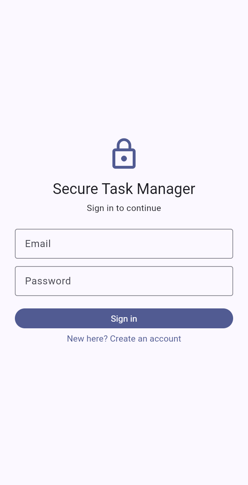 | 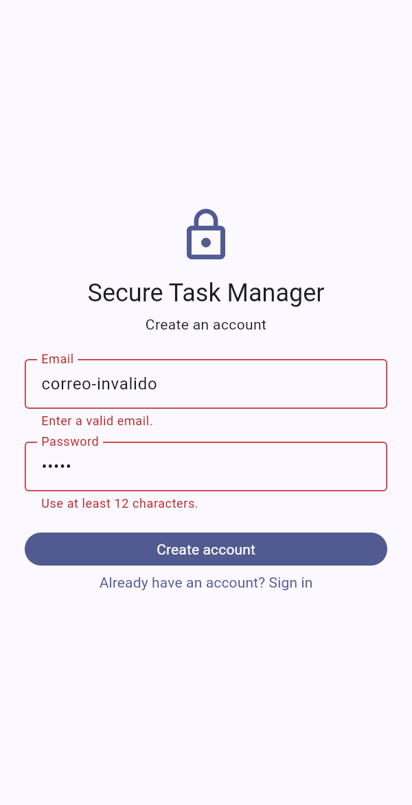 | 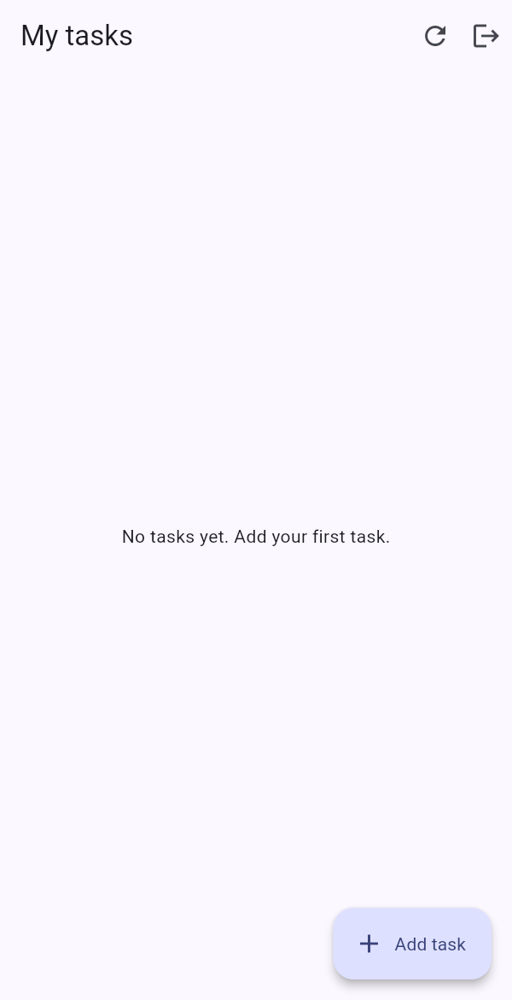 |

| 4. Crear tarea | 5. Lista de tareas | 6. Marcar completada |
|---|---|---|
| 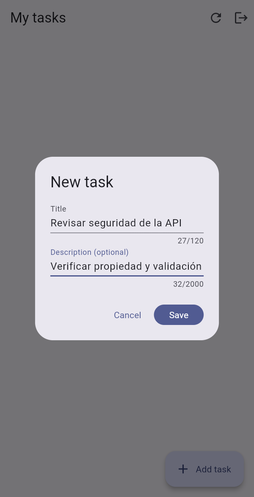 | 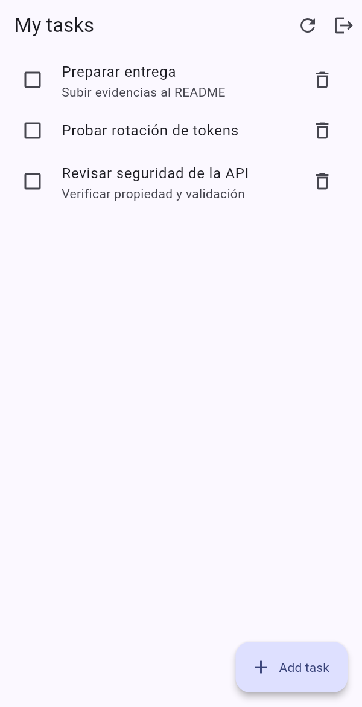 | 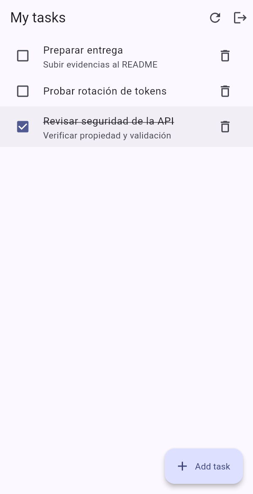 |

| 7. Editar tarea | 8. Confirmación antes de borrar | 9. Tarea eliminada |
|---|---|---|
| 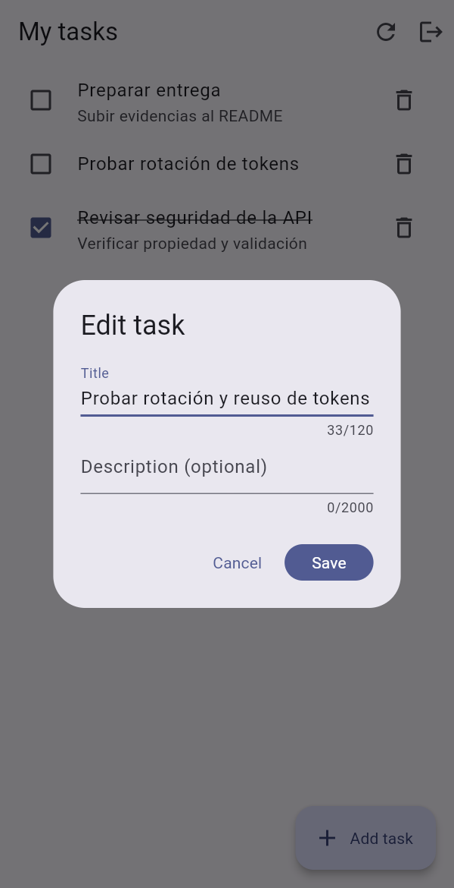 | 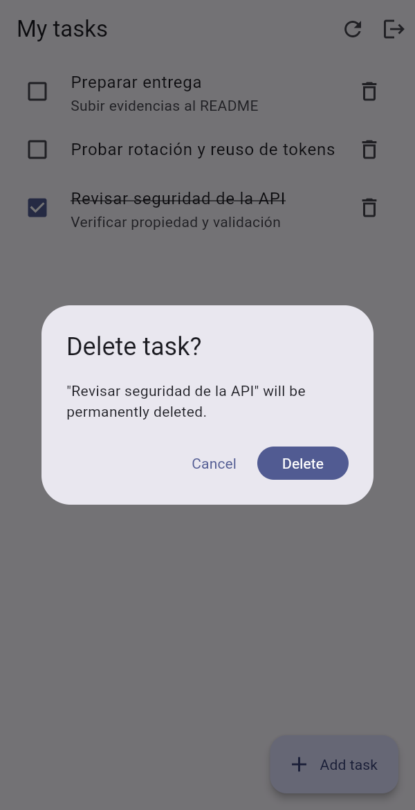 |  |

| 10. Logout (vuelve al login) | 11. Login incorrecto (mensaje genérico) | 12. Nuevo login: datos persistidos |
|---|---|---|
|  | 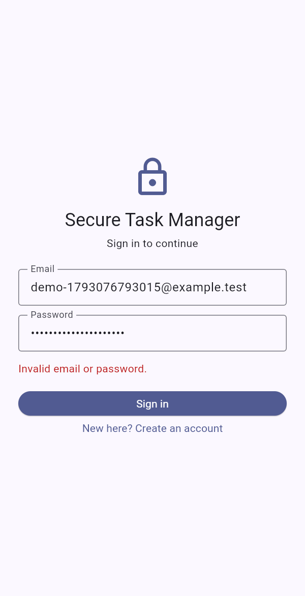 | 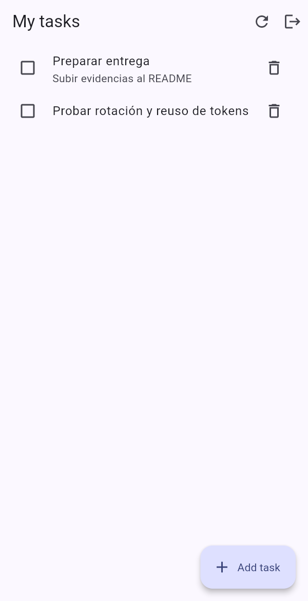 |

## Reflexión (sección 19a)

- **¿Por qué rotar los refresh tokens?** Cada token sirve una sola vez; si alguien roba uno, su ventana de uso termina en cuanto el cliente legítimo vuelve a refrescar.
- **¿Qué pasaría si el servidor guardara los tokens en claro?** Una fuga de la base de datos permitiría suplantar sesiones de inmediato. Con SHA‑256 lo filtrado no se puede presentar a la API.
- **¿Por qué el reuso revoca toda la familia?** El servidor no puede distinguir si quien presenta el token viejo es el atacante o la víctima, así que corta la cadena completa y obliga a iniciar sesión de nuevo.
- **Contrapartida ante reintentos por timeout:** si un cliente legítimo reintenta un refresh cuya respuesta se perdió, presentará un token ya rotado y perderá la sesión. Por eso el cliente Flutter hace *single-flight* y nunca reintenta la llamada de refresh.

> Proyecto de aprendizaje, no una auditoría de seguridad de producción. Antes de desplegar: HTTPS, gestor de secretos, proxy de confianza y revisión de seguridad.
